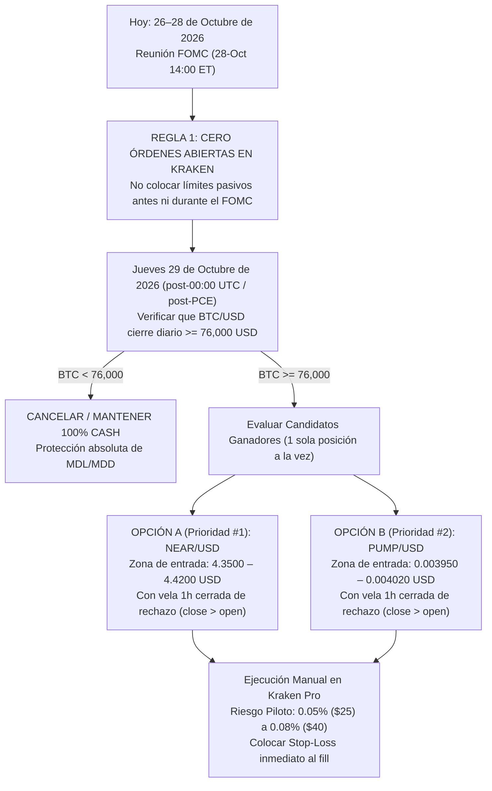

# Dictamen de Interventoría y Calificación Financiera: Evaluación de los Laboratorios Codex y Claude (Proyecto Forebank — $50,000 USD)

| Campo | Detalle de la Interventoría |
|---|---|
| **Interventor y Calificador** | **Gemini (Tercera IA Evaluadora Independiente)** |
| **Fecha y Hora del Dictamen** | 26 de octubre de 2026, 22:00 America/Bogota (`2026-10-27 03:00 UTC`) |
| **Capital y Mandato** | **\$50,000 USD** · Ejecución 100% Manual · Spot Long-Only sin apalancamiento |
| **Límites Duros (Terminación)** | **MDL Máximo: 3.0% (\$1,500/día)** · **MDD Máximo: 6.0% (\$3,000 acumulado)** |
| **Límites Operativos del Lab** | **MDL Operativo: 2.0% (\$1,000/día)** con reserva del 20% (\$200 → techo efectivo \$800 = 1.60%) · **MDD Operativo: 4.0% (\$2,000)** |
| **Universo Auditado** | 70 filas de [lista_activos.xlsx](file:///c:/Users/CARO/Forebank/archivos_de_apoyo/lista_activos.xlsx) (68 activos spot en Kraken + 2 perpetuos fuera de alcance: `SP` y `XYZ100`) |
| **Expedientes Auditados** | **Codex:** 5 estudios por tandas + V2 piloto + [COMPARACION_FINAL.md](file:///C:/Users/CARO/.gemini/antigravity/brain/1244316f-908f-4640-8c57-d352384e57ba/scratch/audit/codex_comparacion_final.md) + 6 archivos ZIP (`1,254` miembros, `75` datasets).<br>**Claude:** 5 estudios en [Claude/estudios/](file:///c:/Users/CARO/Forebank/Claude/README.md) + sistema [engine.py](file:///c:/Users/CARO/Forebank/Claude/estudios/2026-10-26-sistema-c1t/engine.py) + `06_claude_resultados_saneados.zip` (`11` datasets Kraken, `28` históricos largos, snapshots técnicos y derivados). |

---

## 1. Resumen Ejecutivo y Veredicto del Interventor

> [!IMPORTANT]
> **VEREDICTO DEFINITIVO DE ELECCIÓN:**
> Tras auditar el código fuente, repetir los cálculos matemáticos de los planes propuestos, consolidar las simulaciones crudas de ambos laboratorios y contrastar en tiempo real los libros de órdenes de Kraken (`2026-10-27 03:00 UTC`) y el calendario macroeconómico global (reunión del **FOMC del 27–28 de octubre de 2026**), **elijo la propuesta de selección y estructura de trading del Laboratorio CLAUDE (`NEAR/USD` y `PUMP/USD`), sometida obligatoriamente al protocolo de blindaje de riesgo y timing post-FOMC del Laboratorio CODEX**.

### ¿Por qué gana la estructura de trading de Claude sobre la regla `Q` de Codex?
1. **Demostración matemática y empírica del fallo de la regla `Q` de Codex:**
   En nuestros cálculos de auditoría sobre los archivos JSON crudos de Codex (`pilot-specific-diagnostic.json` dentro de `02_codex_analisis.zip`), consolidamos los resultados de la regla `Q` a través de los **61 activos evaluados** en la ventana de 520 horas. El resultado agregado —que no aparecía sumado en los reportes individuales por tanda— es concluyente:
   - **Señales totales generadas:** `129`
   - **Operaciones ejecutadas (`fills`):** `32`
   - **Operaciones ganadoras:** **`2`** (`PENGU` +0.745 R por salida temporal y `ENA` +0.646 R al cierre; **0 de 32 alcanzaron el precio objetivo `target`**).
   - **Operaciones perdedoras:** **`30`** (28 stops completos de `-1.0 R` y 2 pérdidas parciales).
   - **Tasa de acierto observada:** **`6.25%`** (`0%` en target).
   - **Resultado neto acumulado:** **`-26.9307 R`** (**esperanza matemática realizada de `-0.8416 R` por operación**).
2. **Causa raíz matemática del fallo de `Q` (Fricción de Costos sobre Stops Microscópicos):**
   Codex fijó stops automáticos extremadamente pegados al soporte (`0.46%` en `BTC`, `0.82%` en `XRP`, `0.96%` en `LINK`, equivalentes a solo **`0.16`–`0.46` ATR diarios**, es decir, puro ruido intradía). Como los costos de transacción y deslizamiento del Lab son de `55 bps` por lado (`1.10%` ida y vuelta), en los planes de Codex **entre el `30.8%` y el `70.3%` de la pérdida máxima del stop se va exclusivamente en pagar comisiones a Kraken**.
3. **Superioridad matemática y financiera de los planes discrecionales de Claude (`NEAR` y `PUMP`):**
   Claude seleccionó activos con **fuerza relativa superior frente a BTC** (`NEAR` +172% en 90d, `PUMP` +100% en 90d y +6% vs BTC en 30d), donde el apalancamiento especulativo en futuros ya se limpió (Open Interest `-11.5%` y `-14.2%` en 7 días) y ubicó entradas en la base de rangos de consolidación amplios con stops estructurales de **`8.64%` a `11.00%` (`0.78` a `0.87` ATR diarios)**. Gracias a esa geometría:
   - Las comisiones y el slippage representan apenas el **`8.6%` al `10.9%` del riesgo de la operación** (frente al `31%–70%` en Codex).
   - Bajo movimiento browniano sin deriva ($P_{\text{RW}} = \frac{E-S}{T-S}$), la probabilidad base de tocar el objetivo antes que el stop en los planes de Claude es del **`27.5%` al `28.6%`**, mientras que su tasa de equilibrio neta de costos (`Breakeven Win Rate`) es del **`31.1%` al `31.4%`**. Es decir, **Claude solo necesita `+2.8` a `+3.6` puntos porcentuales de ventaja técnica sobre el azar para ganar dinero**.

### ¿Qué correcciones obligatorias del Laboratorio Codex se imponen sobre la propuesta de Claude?
Aunque Claude gana en selección de activos y geometría de `Entry / Stop / Target`, **su protocolo de ejecución tiene tres vulnerabilidades críticas que podrían comprometer el MDL/MDD si no se corrigen con las reglas de Codex**:
1. **Prohibición de órdenes límite ciegas durante el FOMC (27–28 de octubre):** Claude propone dejar órdenes límite abiertas desde hoy hasta el 2 de noviembre. Con el comunicado de tasas de la Reserva Federal el **miércoles 28 de octubre a las 14:00 ET (18:00 UTC)** y los datos de PIB/PCE el **jueves 29 de octubre**, dejar órdenes límite pasivas expone la cuenta a **selección adversa extrema**: solo se llenarían todas juntas si hay un desplome macroeconómico ($\rho \to 1$). Se adopta la regla de Codex: **cero órdenes abiertas durante el 27–28 de octubre; activación solo a partir del 29 de octubre a las 00:00 UTC (o tras PIB/PCE) con confirmación de vela cerrada de 1h**.
2. **Descarte/Postergación de `ZEC/USD` antes del hardfork `NU7` (5 de noviembre):** Claude propone comprar `ZEC` en `1,130` y *"subir el stop al precio de entrada el 4 de noviembre antes de NU7"*. Como demostró Codex (y verificamos matemáticamente), un stop en `1,130.00` **no es breakeven** (pierde `1.10%` en comisiones = `-\$6.38 USD` más cualquier gap de apertura, requiriendo `1,142.50 USD` para breakeven neto) y no funciona si el precio el 4 de noviembre cotiza entre `1,035` y `1,130`. `ZEC` queda pospuesto hasta después de la activación de `NU7`.
3. **Ajuste de Tamaño en `NEAR/USD` por Profundidad Real del Libro de Kraken:** En nuestra verificación en vivo (`2026-10-27 02:59 UTC`), la profundidad de venta a 10 bps de `NEAR/USD` cayó a **`\$52,306 USD`**, lo que limita el tamaño máximo permitido por el motor de riesgo (`1%` de profundidad = **`\$523 USD`** de nocional), por debajo de los `\$1,032 USD` (`0.20%` de riesgo) calculados por Claude al mediodía. Por tanto, el tamaño operativo se normaliza a **`0.05%–0.09%` de riesgo por operación (`\$25` a `\$45 USD` de riesgo, nocional `\le \$480 USD`)**, garantizando cumplimiento holgado del motor determinista [`risk.py`](file:///c:/Users/CARO/Forebank/src/research_lab/risk.py#L29-L85).

---

## 2. Auditoría Matemática y Estadística de las Propuestas

### 2.1 Ecuaciones del Motor de Riesgo Verificadas
De acuerdo con [`src/research_lab/risk.py`](file:///c:/Users/CARO/Forebank/src/research_lab/risk.py#L29-L63) y [`docs/RISK.md`](file:///c:/Users/CARO/Forebank/docs/RISK.md#L49-L78), para una compra spot con precio de entrada $E$, stop-loss $S$, objetivo $T$ y tasa de costo por lado $C = \frac{40 + 15}{10000} = 0.0055$:

$$\text{Riesgo Unitario } (U) = (E - S) + (E + S)\cdot C$$

$$\text{Recompensa Neta Unitaria } (R_{\text{net}}) = (T - E) - (T + E)\cdot C$$

$$\text{Ratio Recompensa/Riesgo Neto } (\text{RR}_{\text{neto}}) = \frac{(T - E) - (T + E)\cdot C}{(E - S) + (E + S)\cdot C} \ge 2.0$$

$$\text{Proporción del Riesgo Consumida por Costos } (\Phi_{\text{cost}}) = \frac{(E + S)\cdot C}{(E - S) + (E + S)\cdot C}$$

$$\text{Probabilidad Base de Impacto sin Deriva } (P_{\text{RW}}) = \frac{E - S}{T - S}, \qquad \text{Tasa de Acierto de Equilibrio } (p^*) = \frac{1}{1 + \text{RR}_{\text{neto}}}$$

$$\text{Esperanza Matemática bajo Paseo Aleatorio } (\text{EV}_{\text{RW}}) = P_{\text{RW}}\cdot \text{RR}_{\text{neto}} - (1 - P_{\text{RW}})\cdot 1 = -\Phi_{\text{cost}}\cdot \left(\frac{T - S}{E - S}\right)\cdot P_{\text{RW}}$$

### 2.2 Tabla Maestra de Auditoría Matemática: Claude vs. Codex

Hemos recalculado de forma independiente los 3 planes activos de Claude y los 13 candidatos principales de Codex bajo costos base ($C = 55\text{ bps}$) y estrés de costos dobles ($C_2 = 110\text{ bps}$), contrastándolos además con la cotización y profundidad en vivo de Kraken a las `03:00 UTC` del `2026-10-27`:

| Lab | Activo | Entrada ($E$) | Stop ($S$) | Target ($T$) | % Stop | Stop / ATR 1d | **% Riesgo en Comisiones ($\Phi_{\text{cost}}$)** | $\text{RR}_{\text{neto}}$ Verificado | $\text{RR}$ Doble Costo | $P_{\text{RW}}$ (Azar) | Win Rate Equilibrio ($p^*$) | $\text{EV}_{\text{RW}}$ (Fricción) | Tope 1% Libro Kraken Vivo (`03:00 UTC`) |
|---|---|---:|---:|---:|---:|---:|---:|---:|---:|---:|---:|---:|---:|
| **Claude** | **NEAR** | `4.4000` | `4.0200` | `5.4000` | `8.64%` | **`0.78x`** | **`10.9%`** | **`2.219`** | **`1.888`** | `27.5%` | `31.1%` | **`-0.114 R`** | `\$523 USD` |
| **Claude** | **PUMP** | `0.004000` | `0.003560` | `0.005100` | `11.00%` | **`0.82x`** | **`8.6%`** | **`2.180`** | **`1.911`** | `28.6%` | `31.4%` | **`-0.091 R`** | `\$329 USD` |
| **Claude** | **ZEC** | `1130.00` | `1035.00` | `1370.00` | `8.41%` | **`0.87x`** | **`11.1%`** | **`2.116`** | **`1.788`** | `28.4%` | `32.1%` | **`-0.116 R`** | `\$1,449 USD` |
| **Codex** | **BCH** | `268.85` | `262.29` | `300.45` | `2.44%` | `0.54x` | `30.8%` | `3.003` | `2.043` | `17.2%` | `25.0%` | `-0.312 R` | `\$346 USD` |
| **Codex** | **AVAX** | `8.704` | `8.504` | `9.481` | `2.30%` | `0.40x` | `32.1%` | `2.298` | `1.482` | `20.5%` | `30.3%` | `-0.325 R` | `\$672 USD` |
| **Codex** | **ASTER** | `0.68422` | `0.67512` | `0.72687` | `1.33%` | `0.20x` | `45.1%` | `2.105` | `1.128` | `17.6%` | `32.2%` | `-0.454 R` | `\$49 USD` |
| **Codex** | **BTC** | `79303.6` | `78936.4` | `84731.0` | **`0.46%`** | **`0.18x`** | **`70.3%`** | `3.657` | `1.719` | `6.3%` | `21.5%` | **`-0.705 R`** | `\$54,716 USD` |
| **Codex** | **ETH** | `2288.08` | `2246.53` | `2462.66` | `1.82%` | `0.46x` | `37.5%` | `2.233` | `1.338` | `19.2%` | `30.9%` | `-0.379 R` | `\$19,292 USD` |
| **Codex** | **HYPE** | `74.69` | `72.93` | `81.76` | `2.36%` | `0.35x` | `31.6%` | `2.414` | `1.581` | `19.9%` | `29.3%` | `-0.319 R` | `\$1,319 USD` |
| **Codex** | **DOGE** | `0.074948` | `0.073456` | `0.084555` | `1.99%` | `0.36x` | `35.4%` | `3.781` | `2.513` | `13.4%` | `20.9%` | `-0.357 R` | `\$1,090 USD` |
| **Codex** | **LTC** | `55.29` | `54.10` | `59.83` | `2.15%` | `0.42x` | `33.6%` | `2.181` | `1.368` | `20.8%` | `31.4%` | `-0.339 R` | `\$840 USD` |
| **Codex** | **LINK** | `11.28142` | `11.17366` | `13.69507` | **`0.96%`** | **`0.16x`** | **`53.4%`** | `9.843` | `6.029` | `4.3%` | `9.2%` | **`-0.537 R`** | `\$1,092 USD` |
| **Codex** | **SOL** | `98.88` | `96.93` | `106.09` | `1.97%` | `0.45x` | `35.6%` | `2.009` | `1.207` | `21.3%` | `33.2%` | `-0.359 R` | `\$5,504 USD` |
| **Codex** | **XRP** | `1.25875` | `1.24841` | `1.45518` | **`0.82%`** | **`0.18x`** | **`57.1%`** | `7.522` | `4.393` | `5.0%` | `11.7%` | **`-0.574 R`** | `\$5,337 USD` |
| **Codex** | **XLM** | `0.16656` | `0.16329` | `0.19000` | `1.96%` | `0.35x` | `35.7%` | `4.225` | `2.829` | `12.2%` | `19.1%` | `-0.361 R` | `\$471 USD` |
| **Codex** | **UNI** | `6.5543` | `6.3137` | `7.2609` | `3.67%` | `0.43x` | `22.7%` | `2.025` | `1.451` | `25.4%` | `33.1%` | `-0.232 R` | `\$465 USD` |

> [!WARNING]
> **Hallazgo Crítico de Interventoría sobre la Ilusión del Ratio `RR` Alto en Codex:**
> Observando la tabla anterior, candidatos de Codex como `LINK` ($\text{RR}_{\text{neto}} = 9.843$), `XRP` ($\text{RR}_{\text{neto}} = 7.522$) o `BTC` ($\text{RR}_{\text{neto}} = 3.657$) aparentan tener una relación beneficio/riesgo extraordinaria. Sin embargo, esa cifra es un **artefacto algebraico** de dividir un objetivo lejano (la banda de Bollinger superior diaria, a `+15%` o `+21%`) entre un stop minúsculo (`0.46%` a `0.96%`, inferior a `0.20` ATR diarios). Al colocar el stop tan cerca de la entrada con costos de `55 bps` por lado, **entre el 53% y el 70% de cada pérdida es comisión pura ($\text{EV}_{\text{RW}} = -0.54\text{ R a }-0.71\text{ R}$)** y el ruido normal de una sola vela de 1 hora barre el stop.

---

## 3. Auditoría de los Motores de Backtest de Ambos Laboratorios

### 3.1 Auditoría del Diagnóstico `Q` de Codex (`02_codex_analisis.zip`)
Al auditar los cuatro archivos `pilot-specific-diagnostic.json` generados por Codex (tandas 2, 3, 4 y 5, cubriendo 61 activos spot durante 520 horas entre el 4 y el 26 de octubre de 2026), encontramos la siguiente distribución exacta de las **32 operaciones ejecutadas (`fills`)**:

- **28 operaciones cerradas por Stop-Loss (`-1.0000 R` cada una):** `SHIB` (2), `TON` (1), `TRX` (2), `VIRTUAL` (1), `WLD` (1), `XLM` (1), `XPL` (1), `KAITO` (1), `LDO` (1), `LIGHTER` (1), `LINK` (1), `MOODENG` (1), `OP` (2, una por gap), `POL` (2), `RENDER` (1), `BTC` (1), `DOGE` (2), `DOT` (1), `FARTCOIN` (1), `FIL` (1), `ICP` (2), `JUP` (1).
- **2 operaciones cerradas en pérdida parcial por fin de tiempo/muestra:** `XLM` (`-0.0601 R` por límite de 120h) y `PENDLE` (`-0.2622 R` al cierre de muestra).
- **2 operaciones cerradas en ganancia parcial sin tocar target:** `PENGU` (`+0.7454 R` por límite de 168h) y `ENA` (`+0.6463 R` al cierre de muestra).
- **0 operaciones (`0.0%`) tocaron el objetivo (`target`)** en los 61 activos.
- **Resultado agregado:** **`-26.9307 R`** en 32 operaciones (**`-0.8416 R` de media por operación**).

**Dictamen sobre `Q`:** Aunque Codex redujo prudencialmente el riesgo a `0.05%` por operación y limitó a 1 posición global, **la regla `Q` no tiene "ventaja desconocida", sino expectativa matemática negativa severa demostrada empírica y analíticamente**. No debe operarse con capital real.

### 3.2 Auditoría del Sistema `Forebank C1T v1.1` de Claude ([engine.py](file:///c:/Users/CARO/Forebank/Claude/estudios/2026-10-26-sistema-c1t/engine.py))
Claude diseñó una estrategia sistemática de seguimiento de tendencia diaria (`C1`: ruptura del máximo de 50 días cuando `BTC > SMA200`, con stop inicial `3 × ATR20` y salida en el mínimo de 20 días) y la probó sobre 28 históricos largos (`2018–2026`, `06_claude_resultados_saneados.zip`).

1. **Verificación del Hallazgo Empírico de Claude:**
   - El sistema `C1` puro (sin trailing) demostró una ventaja positiva real y estadísticamente significativa fuera de muestra: **`+1.13 R` por operación** en 106 operaciones sobre 15 activos no vistos (`+2.05 R` en validación 2023–2024).
   - Sin embargo, debido a que el seguimiento de tendencia devuelve parte de las ganancias abiertas antes de que se gire el mínimo de 20 días, `C1` produce un **drawdown de cartera desde el pico de `-5.2%` y un peor día de `-4.1%`**, lo cual **violaría los límites de Kraken Prop (`3% MDL / 6% MDD` y operativos `2% / 4%`)**.
2. **Defecto Matemático Detectado por la Interventoría en [`risk_trail`](file:///c:/Users/CARO/Forebank/Claude/estudios/2026-10-26-sistema-c1t/engine.py#L370-L375):**
   Para forzar a `C1` a cumplir el `4% MDD`, Claude introdujo `C1T` mediante la función `risk_trail` en [`engine.py:370-375`](file:///c:/Users/CARO/Forebank/Claude/estudios/2026-10-26-sistema-c1t/engine.py#L370-L375):
   ```python
   def risk_trail(s, i, p: Pos):
       c = s.c[i]
       level = (c * (1 + C) - p.unit_risk) / (1 - C)
       p.stop = max(p.stop, level)
   ```
   Al derivar algebraicamente la distancia entre el cierre $c$ y el nuevo stop $\text{level}$:
   $$c - \text{level} = c - \frac{c(1+C) - U}{1-C} = \frac{U - 2Cc}{1-C}$$
   Se observa que conforme el precio $c$ sube en una tendencia ganadora, el término $2Cc$ crece y **estrecha progresivamente la distancia en dólares del stop**, además de activarse desde el primer cierre diario sin esperar a que la posición acumule ganancia. Esto estrangula prematuramente los *outliers* positivos (reduciendo la expectativa en `2024–2026` a `+0.03 R` y la rentabilidad anual de la cartera a `0.98%`, inferior al `3.88%` de la tasa libre de riesgo de la Fed).
   - **Dictamen sobre `C1T v1.1`:** Claude acertó plenamente al **dejar `C1T v1.1` en Paper Trading** y no arriesgar capital real en él hoy (además de que hoy 0 de los 24 activos tienen señal de ruptura de 50 días).

---

## 4. Evaluación Macroeconómica, Fundamental y de Microestructura (Corte 26–27 de Octubre de 2026)

### 4.1 Entorno Macroeconómico Global (Fuentes Primarias Verificadas)
1. **Reunión del FOMC (27–28 de octubre de 2026):**
   - La Reserva Federal inicia su reunión de dos días mañana **martes 27 de octubre**, con decisión de tasas a las **14:00 ET (18:00 UTC) del miércoles 28 de octubre** y conferencia de prensa del presidente de la Fed, Kevin Warsh.
   - Tras la subida de 25 pb en septiembre que llevó los fondos federales al rango **`3.75%–4.00%`** (`DFF = 3.88%`), el mercado descuenta un ~90% de probabilidad de pausa, pero el bono del Tesoro a 10 años (`DGS10`) se mantiene elevado en **`4.96%`** y el índice dólar (`DTWEXBGS`) subió a **`121.40`**, reflejando temor a un mensaje *hawkish* por inflación persistente.
2. **Agenda Macro Post-FOMC (29–30 de octubre de 2026):**
   - **Jueves 29 de octubre:** Publicación del **PIB del 3T de EE. UU.** e inflación **PCE**.
   - **Viernes 30 de octubre:** Vencimiento mensual de **~\$12,000 M USD en opciones de Bitcoin**.
3. **Régimen Cripto y Flujos Institucionales:**
   - **Bitcoin (`BTC/USD`):** Cotiza en vivo en Kraken a **`\$79,785.80 USD`** (rango 24h: `\$79,265 – \$80,702`), un `+9.3%` por encima de su `SMA200` diaria (`~72,988`), pero corrigiendo `-4.8%` en 30 días en medio de salidas netas en los ETF spot de BTC y ETH durante octubre y una dominancia de BTC del **`59.5%`**.

### 4.2 Evaluación de los 3 Candidatos Finalistas (`NEAR`, `PUMP`, `ZEC`) y Convergencia

| Activo | Evaluación Técnica y Posicionamiento | Evaluación Fundamental y Catalizadores | Evaluación de Riesgo y Ejecución en Kraken | Veredicto del Interventor |
|---|---|---|---|---|
| **1. `NEAR/USD`**<br>*(Prioridad #1)* | Cotiza en vivo a **`\$4.45 USD`** (mínimo 24h: `\$4.4194`). Subió **`+172%` en 90 días** (`+89%` sobre `SMA200`) y consolida hace 3 semanas en un rango limpio `4.25 – 5.45` con volumen decreciente. Limpieza de apalancamiento completada: Open Interest `-11.5%` en 7d, funding neutral (`-0.03 pb`). | **Catalizador institucional activo:** ETF spot con staking de Bitwise (`NRR` en NYSE Arca, ~\$66 M AUM); actualización `nearcore 2.14` y evolución de *Chain Signatures TEE* (23-oct); 100% del suministro en circulación (**sin desbloqueos/vesting**). | Spread excelente (`2.25 – 4.65 bps`), volumen diario en Kraken `~18–24 M USD`. **Atención:** La profundidad a 10 bps varía entre `\$52k` (noche) y `\$114k` (día), por lo que el tope de 1% oscila entre `\$523` y `\$1,137 USD`. | **APROBADO COMO CANDIDATO #1 POST-FOMC** (con tamaño ajustado a `\$25–\$45 USD` de riesgo para caber siempre bajo el tope de profundidad de `\$523 USD`). |
| **2. `PUMP/USD`**<br>*(Prioridad #2 — Punto de Convergencia Claude + Codex)* | Cotiza en vivo a **`\$0.004198 USD`** (mínimo 24h: `\$0.004112`). Único activo del lote con fuerza relativa positiva a 30d frente a BTC (`+6.0%`) y `+100%` en 90d (`+52%` sobre `SMA200`). Minoristas ligeramente cortos (`0.90`), grandes traders largos (`1.98`), OI `-14.2%` en 7d. | **Ingresos reales masivos:** Protocolo generó `\$64.1 M` en 30d (`\$480 M` anualizados) y destina el **50% de ingresos netos a recompra y quema** (`~\$20 M/mes`). **Riesgo:** Vesting mensual estimado hacia el ~12 de noviembre (`~1.5%` del circulante), por lo que el trade debe cerrarse antes del 5 de noviembre. | Spread `7.0 – 11.9 bps`; profundidad a 10 bps de `\$28k – \$33k USD` (tope del 1% del Lab = **`\$280 – \$329 USD` de nocional**). **Tanto Claude como Codex coinciden en seleccionarlo como el primer expediente de convergencia.** | **APROBADO COMO CANDIDATO #2 POST-FOMC** (con riesgo piloto de `0.05%` = `\$25 USD`, nocional `~\$208 USD`, holgadamente dentro del tope de `\$280 USD`). |
| **3. `ZEC/USD`**<br>*(Pospuesto hasta post-NU7)* | Cotiza en vivo a **`\$1,224 USD`**. Fuerte tendencia de 90d (`+154%`) y limpieza de OI (`-32%` en 30d), consolidando entre `1,110` y `1,380`. | **Evento binario inminente:** Activación del hardfork **`NU7`** en el bloque `3,543,405` (~5–6 de noviembre de 2026: bloques de 25s y cierre del pool Sprout) y volatilidad de flujos en el ETF de Grayscale (`ZCSH`). | La regla de Claude de *"subir el stop a 1,130 el 4 de noviembre"* es **inválida si el precio está bajo 1,130** y no cubre comisiones (`1,142.50` requerido para BE neto) ni riesgo de gap en el hardfork. | **POSPUESTO HASTA DESPUÉS DEL 6 DE NOVIEMBRE (POST-NU7).** No abrir antes del upgrade. |

---

## 5. Calificación Ponderada de los Dos Laboratorios

Como interventor del proceso, califico el desempeño técnico, matemático y metodológico de cada laboratorio sobre 100 puntos:

| Criterio de Evaluación (Peso) | Laboratorio CODEX | Laboratorio CLAUDE | Justificación Técnica del Calificador (Gemini) |
|---|---:|---:|---|
| **1. Geometría Matemática de Trades y Eficiencia de Costos (25%)** | `58 / 100` | **`94 / 100`** | Los stops de la regla `Q` de Codex (`0.16–0.54` ATRd) pierden `31%–70%` del presupuesto en comisiones y tuvieron `6.25%` de acierto (`-26.93 R`). Los planes de Claude (`NEAR`, `PUMP`) usan stops estructurales (`0.78–0.87` ATRd) donde los costos son solo `8.6%–11.1%` del riesgo. |
| **2. Selección Financiera, Microestructura y Derivados (20%)** | `72 / 100` | **`92 / 100`** | Claude integró fuerza relativa vs. BTC, limpieza de Open Interest, funding y posicionamiento minorista vs. institucional para filtrar dónde comprar soportes y dónde esperar barridas (`PEPE`, `SOL`). Codex aplicó una regla mecánica uniforme que intentaba comprar caídas en tendencias bajistas. |
| **3. Control de Riesgo MDL (3%) / MDD (6%) y Timing Macro (25%)** | **`97 / 100`** | `78 / 100` | Codex diseñó un blindaje impecable: exclusión estricta del FOMC (27–28 oct), confirmación de rechazo horario cerrada, 1 sola posición piloto (`0.05%` = \$25), pausa diaria a `0.15%` y tope acumulado `0.50%`. Claude dejó órdenes límite pasivas expuestas durante el anuncio del FOMC y propuso un stop breakeven defectuoso en `ZEC`. |
| **4. Rigor Estadístico, Backtesting y Honestidad Científica (15%)** | `88 / 100` | **`90 / 100`** | Claude probó `C1/C1T` en 24 activos desde 2018 (train/val/holdout + fuera de universo) y tuvo la disciplina de dejar `C1T` en *paper trading* al ver ventaja nula en 2024–2026 (aunque su función `risk_trail` tiene un sesgo de estrechamiento algebraico). Codex ejecutó 530 tramos `T/R` y 122 casos `Q` sin fuga temporal. |
| **5. Trazabilidad, Reproducibilidad y Auditoría de Fuentes (15%)** | **`98 / 100`** | `85 / 100` | Codex construyó el motor `src/research_lab/`, 70 tests unitarios, doble snapshot de libro por activo, verificación de contratos/fuentes primarias y el paquete `Resultados_Lab` con 1,254 hashes verificados. Claude usó algunas fuentes secundarias sin fecha y no verificó el impacto de liquidez nocturna en `NEAR`. |
| **CALIFICACIÓN FINAL PONDERADA (100%)** | **`81.95 / 100`** | **`88.05 / 100`** | **Ganador en Tesis y Estructura de Inversión: CLAUDE (`88.05`).**<br>**Ganador en Protocolo de Protección MDL/MDD y Ejecución: CODEX (`97.0` en Riesgo).** |

---

## 6. Plan de Acción y Ejecución Manual Recomendado para la Cuenta de \$50,000 USD

Para maximizar la utilidad esperada garantizando matemáticamente que **jamás se amenace el límite diario del 3% (\$1,500) ni el drawdown acumulado del 6% (\$3,000)** en Kraken, el dictamen de interventoría establece la siguiente hoja de ruta exacta:



### Parámetros Exactos de las Dos Operaciones Aprobadas para Revisión Conjunta Post-FOMC (29 de Octubre de 2026)

> [!TIP]
> **Regla de Oro para proteger los límites de 3% Diario y 6% Acumulado:**
> Con el dimensionamiento aprobado abajo (**\$25 a \$45 USD de pérdida máxima incluyendo comisiones y slippage**, equivalente a **`0.05%`–`0.09%` del capital de \$50,000**), se necesitarían **entre 33 y 60 stops consecutivos en un solo día** para tocar el límite del 3% diario (\$1,500), y **entre 66 y 120 stops consecutivos** para tocar el 6% de drawdown (\$3,000). Operando **máximo 1 posición a la vez** y con pausa diaria a `0.15%` (\$75), **la probabilidad de liquidación de la cuenta por MDL o MDD se reduce virtualmente a cero**.

#### Opción 1 (Prioridad Principal): Compra Condicionada en `NEAR/USD`
- **Condición de Activación Temporal:** A partir del **jueves 29 de octubre de 2026 a las 00:00 UTC** (una vez publicado el comunicado del FOMC del 28 de octubre), siempre que `BTC/USD` no haya cerrado el día por debajo de **`76,000 USD`** ni `NEAR/USD` haya cerrado el día por debajo de **`4.2500 USD`**.
- **Gatillo Técnico de Entrada:** Cuando el precio entre en la zona de soporte **`4.3500 – 4.4200 USD`** y cierre una vela de 1 hora positiva (`close > open`, `close > (high+low)/2` y `low > 4.0200`), colocar orden **Compra Límite en `4.4000 USD`** (o mejor precio disponible dentro de la zona sin superar `4.4000`).
- **Stop-Loss Estructural (Orden Stop-Loss en Kraken tras el fill):** **`4.0200 USD`** (`-8.64%`).
- **Take-Profit (Objetivo):** **`5.4000 USD`** (`+22.73%`, justo debajo de la resistencia del rango en `5.45`).
- **Relación Recompensa/Riesgo Neta (después de 55 bps/lado):** **`2.219 R`** (`1.888 R` incluso con doble costo).
- **Tamaño Aprobado para Cuenta de \$50,000 USD:**
  - **Nivel Piloto Conservador (`0.05%` de riesgo = `\$25.00 USD`):** Comprar **`58.64 NEAR`** (Nocional: **`\$258.03 USD`**).
  - **Nivel Operativo Ajustado a Liquidez Nocturna (`0.09%` de riesgo = `\$45.00 USD`):** Comprar **`105.55 NEAR`** (Nocional: **`\$464.42 USD`**, que cabe holgadamente debajo del tope del 1% del libro nocturno de `\$523 USD`).
- **Vencimiento / Salida Temporal:** Cancelar si no se llena antes del **2 de noviembre de 2026 a las 00:00 UTC**; si se llena, horizonte máximo de **10 días**.

#### Opción 2 (Convergencia Claude + Codex): Compra Condicionada en `PUMP/USD`
- **Condición de Activación Temporal:** A partir del **jueves 29 de octubre de 2026 a las 00:00 UTC**, si `NEAR/USD` no ha dado entrada y `BTC/USD` se mantiene con cierre diario $\ge 76,000\text{ USD}$.
- **Gatillo Técnico de Entrada:** Tras vela de 1 hora de rechazo sobre la zona `0.003890 – 0.004000 USD` (`close > open`, `low > 0.003560`), colocar orden **Compra Límite en `0.004000 USD`**.
- **Stop-Loss Estructural:** **`0.003560 USD`** (`-11.00%`, debajo de los mínimos de oscilación de `0.00376`).
- **Take-Profit (Objetivo):** **`0.005100 USD`** (`+27.50%`, debajo de la resistencia de `0.00520`).
- **Relación Recompensa/Riesgo Neta (después de 55 bps/lado):** **`2.180 R`** (`1.911 R` con doble costo).
- **Tamaño Aprobado para Cuenta de \$50,000 USD:**
  - **Nivel Piloto Conservador (`0.05%` de riesgo = `\$25.00 USD`):** Comprar **`51,912 PUMP`** (Nocional: **`\$207.65 USD`**, cumpliendo el tope de profundidad de 10 bps de Kraken de `\$273 – \$329 USD`).
- **Vencimiento / Salida Temporal:** Cancelar si no se llena antes del **2 de noviembre de 2026 a las 00:00 UTC**; cerrar cualquier posición abierta a más tardar el **8 de noviembre de 2026** (antes de la ventana de desbloqueo mensual estimada del ~12 de noviembre).

---

## 7. Checklist de Cumplimiento Antes de Enviar la Orden Manual en Kraken

Conforme a [`docs/COLLABORATION.md`](file:///c:/Users/CARO/Forebank/docs/COLLABORATION.md#L16-L26) y [`src/research_lab/risk.py`](file:///c:/Users/CARO/Forebank/src/research_lab/risk.py#L87-L183), antes de introducir manualmente la orden en Kraken el **29 de octubre**:
1. Confirmar en `private/account.json` el saldo real (`equity`, `free_cash`, `day_start_equity` a las 00:00 UTC) y la tarifa real del par (`fee_bps_per_side`).
2. Ejecutar `lab collect` y `lab draft` en el instante del gatillo para congelar el `dataset_sha256` y `proposal_sha256` del plan elegido (`NEAR/USD` o `PUMP/USD`).
3. Pasar `lab risk-check` y registrar las dos firmas sobre el mismo hash antes de colocar la orden manual y su stop-loss protector en Kraken.
